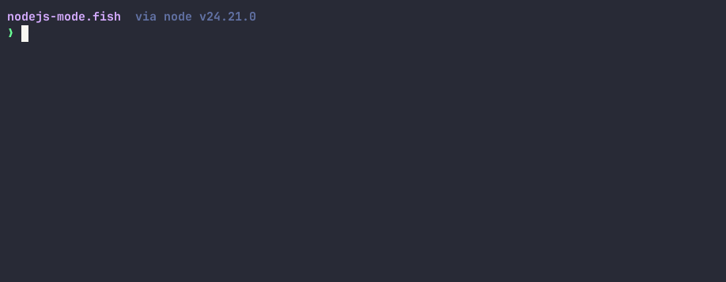

<div align="center">

# nodejs-mode.fish

**Press `Ctrl-X` and your fish prompt becomes a Node.js REPL.**

zx's `` $`...` ``, shelljs commands, lodash's `_`, TypeScript, auto-require, tab completion —
and when you go back to fish, the working directory and environment are still there.

[](https://nodejs.org)
[](https://fishshell.com)
[](https://asciinema.org/a/1270822)

[](https://asciinema.org/a/1270822)

*A real session: zx, the completion menu, a typed const, `cd` — and back in fish.*

</div>

```console
nodejs-mode.fish  via node v24.21.0
❯                       # press Ctrl-X here
js ❯ const t = await $`uname -s`
Linux
js ❯ t.stdout.trim()
'Linux'
js ❯ const n: number = 42
js ❯ n + 1
43
js ❯ _.chunk([1, 2, 3, 4], 2)
[ [ 1, 2 ], [ 3, 4 ] ]
js ❯ (Ctrl-D)
nodejs-mode.fish  via node v24.21.0
❯
```

## Install

```fish
yarn install
ln -s (realpath fish/conf.d/nodejs-mode.fish) ~/.config/fish/conf.d/
exec fish
```

- requires `node >= 22.18` (it runs `.ts` directly — no build step)
- requires `fish >= 4.0` (developed on 4.9.3)
- dependencies are managed with yarn berry; there's a `flake.nix`, so `direnv allow` or `nix develop` works too

## What's in there

| | |
|---|---|
| **`$` is zx** | `` $`...` ``, `.pipe()`, `.nothrow()`, `.text()`, top-level `await`; a bare command gets `stdio: inherit`, so `vim` / `ssh` / `less` get a real tty |
| **Globals** | every zx export, every shelljs command, and `_` (lodash) — no imports needed |
| **Auto-require** | a name that isn't defined anywhere in the global scope is tried as `require(name)` (resolved from the cwd), so `fs.readFileSync(...)` and `os.uptime()` just work |
| **TypeScript** | type annotations, `enum`, `import type` — powered by Node's own `stripTypeScriptTypes`; no tsx or esbuild needed |
| **import** | a static `import x from "y"` is rewritten to `await import()`; dynamic `import()` resolves from the cwd; `require("./x.ts")` works too |
| **cwd / env** | changes made by `cd()` and `process.env` are written back to fish; a `cd` you do in fish is picked up when you re-enter |
| **Completion** | Tab: declared names, globals, properties after `obj.`, and paths; multiple candidates are listed under the input line and Tab cycles through them (the current one is inverted). Inside `` $`...` `` it hands over to fish, so commands, flags and files come with their descriptions |
| **State** | one daemon per fish session keeps variables and functions across commands, and is cleaned up on `fish_exit` |

## Keys

| Key | Action |
|---|---|
| `Ctrl-X` | enter from fish (the current command line becomes the `` $`...` `` seed); exits when already in the mode |
| `Ctrl-D` | leave, back to fish |
| `Enter` (completion menu open) | accept the highlighted candidate and close the menu, **without running it** — press again to run (same as fish) |
| `Enter` on an empty line | open a fresh `js ❯` line, stay in the mode |
| `Ctrl-C` | keep what you typed, add `^C`, start a new line; while evaluating, it kills the command's child processes |
| `Tab` | completion (see above) — inside `` $`...` `` fish completes it |
| `Up` / `Down` | history (stored separately from fish's) |
| `Ctrl-A/E/B/F/K/U/W` | line editing |

## Batch mode

`nodejs-mode` is also a command: the same entry point as `Ctrl-X`, usable anywhere in fish.

```console
$ nodejs-mode                     # enter the repl (same as Ctrl-X)
$ nodejs-mode -c '1 + 1'          # one command
2
$ nodejs-mode build.ts            # one file — "$", "_", shelljs and TypeScript included
$ echo '40 + 2' | nodejs-mode     # code on stdin
42
```

It always goes through the session daemon — the same one `Ctrl-X` uses: if there isn't one yet, the fish
function starts it exactly the way `Ctrl-X` would, and `Ctrl-X` later picks it up with the state the script
left behind. `-c <code>` and `-f <file>` (or `-f -` for stdin) are the flags underneath; `boot.ts` itself
takes `--socket`, which is what the fish function hands it. There is no in-process mode: a command without a
daemon to talk to is an error, not a second way to run code.

## Why every command goes back to fish

Each command is a short-lived node process: connect to the daemon, evaluate, exit — then fish redraws
its prompt from real state and the mode re-enters itself. That's why cwd, git branch and the clock are
fresh for every command, and the prompt can never disagree with the shell.

The cost is one process spawn per command: ~100ms for the client, ~2ms for the round trip inside the
daemon (measured). What you get back is a prompt that is always authoritative.

## Architecture

```
Ctrl-X ─▶ nodejs-mode-enter ─▶ boot.ts (paints the prompt first) ─▶ cli.ts
              ▲                                                    │
              │                                                    ├─ eval  ─▶ daemon (variables / cwd / env live here)
              │                                                    └─ spawn ─▶ child process (bare commands get a real tty)
              └──── fish repaint ◀── exit 42 ◀─────────────────────┘
```

`cli.ts` is one process per command; `daemon.ts` is one process per fish session and they talk over a
unix socket.

## Known limitations

- `Ctrl-C` only kills child processes; a plain `await new Promise(...)` can't be interrupted.
- If the daemon dies, the command in flight is lost (you get a notice, exit 43, and fish restarts it) — retype it.
- An interactive child in capture mode (`const o = await $`vim``) degrades to a dumb terminal, because stdout is a pipe.
- Anything that reads stdin, like `question()`, doesn't work: the daemon's stdin is `/dev/null`.
- A script run through the daemon that calls `process.exit()` takes the daemon down with it; the next command starts a new one.
- The daemon runs the code it was started with, so restart fish after editing the repo.
- TypeScript is handled lazily (compile as JS first, strip types only if that fails), so the source snippet in a TS error is the transformed one.
- If `fish_prompt` is wider than the terminal (it wraps), entering/exiting leaves half of the old prompt above the block.
- The completion menu stops at 8 rows.
- Only verified on fish 4.9.3 and node 24.

## Development

```fish
yarn typecheck        # tsc --noEmit
yarn test             # node --test
```

pty regression (drives a real fish in a pty and dumps the screen):

```fish
node scripts/pty-drive.mjs '[{"d":400,"s":"\u0018"},{"d":900,"s":"1 + 1\r"},{"d":600,"s":"\u0004"}]'
node scripts/pty-drive.mjs '[{"d":400,"s":"\u0018"},{"d":900,"s":"1 + 1\r"},{"d":600,"s":"\u0004"}]' two vi
```

`\u0018` is `Ctrl-X`, `\u0004` is `Ctrl-D`; the third argument `two` / `three` switches to a multi-line
prompt and `vi` enables `fish_vi_key_bindings`. A `{"run": "command"}` step runs a shell command on the
host (e.g. `kill -9` the daemon to check recovery).

The screen is rendered with `@xterm/headless` (a dev dependency), but it can only verify behaviour: the
fish inside the harness runs with `--no-config`, and it repaints its prompt differently (it draws `⏎`
marker lines and never moves the cursor up) than a real, fully configured shell. So **cursor geometry
can't be judged there** — check it in a real terminal.

## Layout

```
src/boot.ts       entry: -c, or the header + js ❯ first, then loads everything else (first-paint latency)
src/batch.ts      -c/-f: run once through the session daemon, print the value, exit 0/1
src/cli.ts        the client: connect, raw mode, key loop, redraw, exit, state write-back
src/editor.ts     line buffer + key handling + history
src/highlight.ts  Lezer parsing + shell-fragment colouring + top-level await rewrite + name collection
src/fish.ts       fish's own completion (complete -C) and shell quoting, for $`…`
src/render.ts     everything ANSI: prompt, colours, wrapping, cursor placement, completion menu
src/keys.ts       byte stream -> key events
src/width.ts      display width (string-width)
src/eval.ts       persistent context + zx shell + require/cd + AbortSignal (runs inside the daemon)
src/ts.ts         strip TypeScript types + rewrite static imports
src/daemon.ts     the per-session daemon: socket, pid file, cwd/env state, abort
src/remote.ts     client side: NDJSON connection + local spawn
src/protocol.ts   message types + the stand-in for a remote ChildProcess
src/state.ts      turns the cwd/env diff into fish code / applies an env snapshot
src/output.ts     rendering of errors and values (shared by client and daemon)
src/args.ts       CLI arguments (node:util parseArgs)
fish/conf.d/      fish side: bindings, the nodejs-mode command, prompt capture, the loop, daemon lifecycle
scripts/          the real-pty regression driver (script + @xterm/headless)
docs/demo.cast    the recording the GIF is generated from (agg docs/demo.cast docs/demo.gif)
docs/demo.gif     the demo above, also playable at asciinema.org/a/1270822
```
